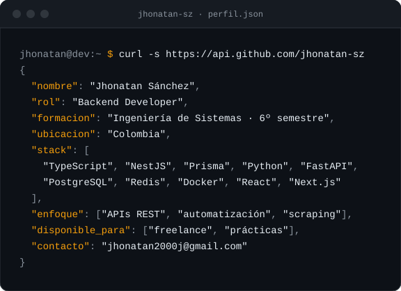

  

> **EN — short version:** Systems Engineering student (6th semester), backend-focused.
> I build REST APIs with NestJS/Prisma and FastAPI/PostgreSQL, plus Python automation and
> scraping scripts. Open to small freelance work: bug fixes and data extraction.

## Sobre mí

Desarrollador backend, estudiante de Ingeniería de Sistemas (6º semestre). Construyo APIs
con NestJS + Prisma y FastAPI + PostgreSQL, y automatizo con Python lo que antes se hacía
a mano: scraping, extracción de datos y procesos que corren solos.

Me interesa el problema completo: modelar los datos, asegurar los endpoints, dejarlos
dockerizados y cubiertos con tests. Cuando el proyecto lo pide, también trabajo el
frontend con Next.js o React.

## Stack

  
  
  
  
  
  
  
  
  
  
  
  
  
  
  
  
  
  
  

## Entornos

  
  
  
  
  
  
  

## Proyectos

### [`book-scraper`](https://github.com/jhonatan-sz/book-scraper)

**Problema:** extraer un catálogo completo de 1000 libros repartido en 50 páginas de
listado, sin duplicados y con los datos validados.

**Solución:** el listado descubre URLs y cada página de detalle es la fuente canónica
(título, precio, rating, stock, categoría). Deduplicación por URL, salida CSV o JSON
validada, y tests sobre fixtures HTML guardados para no golpear el sitio en cada corrida.

**Stack:** Python (solo stdlib en runtime), pytest, uv.

### `lynx-stats-backend` — privado

**Problema:** API para estadísticas deportivas, con ingestión pesada y consultas
frecuentes sobre la misma data.

**Solución:** FastAPI async con SQLAlchemy, PostgreSQL y migraciones con Alembic, caché y
colas en segundo plano con Redis + arq, todo levantado con docker-compose y cubierto con
pytest.

**Estado:** pausado. El modelo predictivo no superó el baseline, así que no lo publiqué
como producto. El código sigue privado; la arquitectura es lo que quedó de ese trabajo.

## Ahora mismo

Construyendo una API de referencia con **NestJS + Prisma** — auth con JWT, roles,
migraciones, Swagger, tests y docker-compose — para tener mi stack de backend público y
reutilizable como base de proyectos.

## Actividad

  <picture>
    <source media="(prefers-color-scheme: dark)" srcset="https://raw.githubusercontent.com/jhonatan-sz/jhonatan-sz/output/github-snake-dark.svg" />
    
  </picture>

## Contacto

Abierto a trabajos freelance pequeños: arreglo de bugs en Python / JS / TS, scripts de
automatización y extracción de datos.

