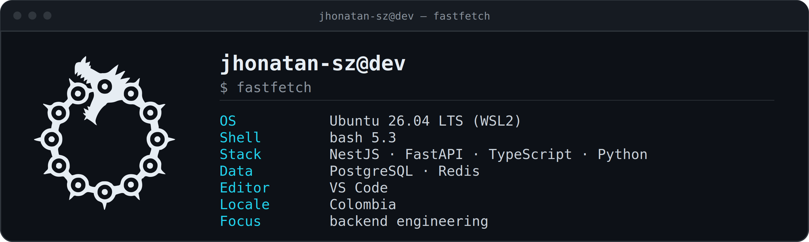

  

### Sobre mí

Soy estudiante de Ingeniería de Sistemas, orientado a **backend engineering**. Diseño y construyo APIs con NestJS, FastAPI y PostgreSQL, con foco en modelado de datos, concurrencia y testing. Me interesa el ciclo completo: del esquema relacional al despliegue, con decisiones medibles.

### Enfoque

Backend Engineering · APIs · Bases de datos · Concurrencia · Automatización

### Stack

  
  
  
  
  
  
  
  
  
  
  
  
  
  

### Entorno

  
  
  
  
  
  
  

---

### Contacto

Abierto a oportunidades backend.

  
  

